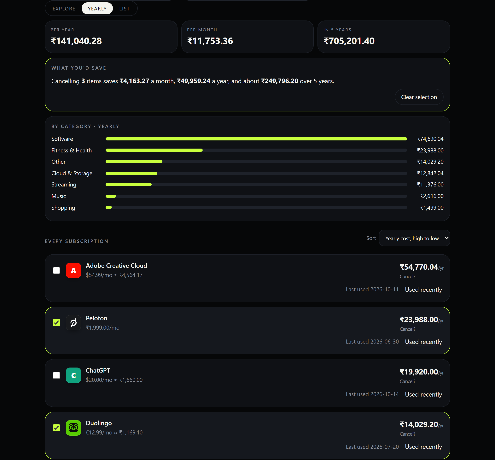
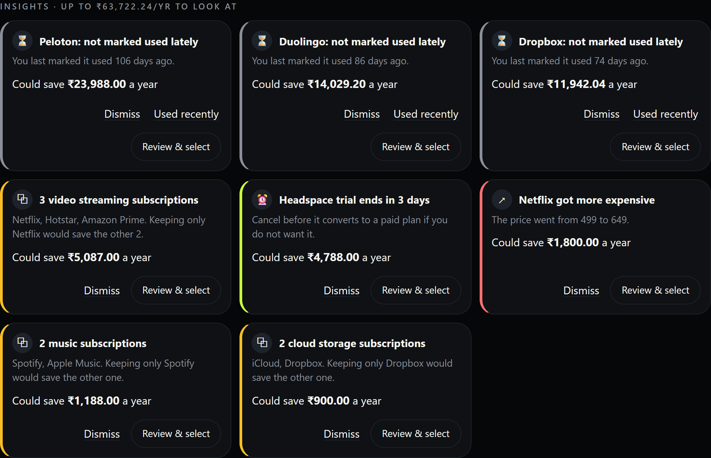
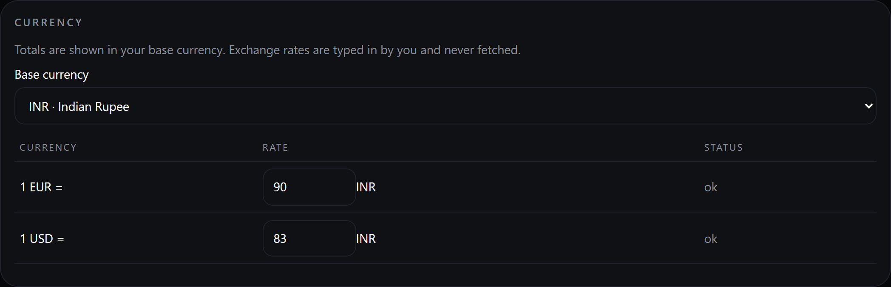

# SubSweep

Find, understand and get out of forgotten subscriptions. SubSweep reads your bank statement, spots the recurring charges, and tells you what they really cost per year. It also checks that a cancellation actually stopped the charges. Everything runs in your browser: statements are parsed locally, data lives in IndexedDB, and nothing is ever uploaded.

> **Live demo:** SubSweep isn't deployed yet (a Vercel deploy is on the roadmap). It is a static site, so you can run it locally in a minute (see [Run](#run)) or put the `dist/` folder on any static host. The screenshots below are taken from the running app with the demo data in `sample-data/`.

## Features
- Scan a bank/card statement CSV → detects recurring charges (weekly/monthly/quarterly/yearly) and flags price creep
- Manual add/edit, free-trial flag, categories
- Possible-duplicates banner: similar subscriptions can be merged (only when you click) or dismissed
- Multi-currency totals with manual exchange rates, a yearly cost view, a "what you'd save" simulator and overlap / unused insights
- Cancel & verify: a cancellation kit per service, tracking of what you cancelled, a check that charges really stopped and a dispute message if they did not
- JSON backup and restore (Merge or Replace) so your data is never stuck in one browser
- Dashboard: monthly/yearly totals, category breakdown, renewals in the next 7 days
- Reminders: browser notifications (when the app is opened) + `.ics` calendar export with 1-day-before alarms
- "How to cancel" hints per service
- Installable PWA, light/dark mode

## Screenshots

| | |
|---|---|
| **Yearly view and "what you'd save" simulator.** Tick *Cancel?* to see the monthly, yearly and 5-year savings. | **Insights.** Overlapping services, unused subscriptions, price hikes and trials about to convert. |
|  |  |
| **Cancel kit.** Steps, a direct account link, how hard the service is to leave, and message templates. | **Still charging.** A charge after the paid period is flagged, with a dispute message ready to copy. |
|  |  |
| **Scan a statement.** Recurring charges are found for you, with price creep called out. | **Multi-currency.** Manual exchange rates, kept on your device. |
|  |  |
| **Missing rates are never ignored.** The item is left out of totals and you are told. | **Light and dark themes.** |
|  |  |

On a phone the app switches to a list layout:

  
  

## Try it with demo data
1. `npm install && npm run dev`, then open the printed local address.
2. Choose **Restore from backup** (bottom of the page) and pick [`sample-data/demo-backup.json`](sample-data/demo-backup.json), then **Merge**. You get 14 subscriptions in INR, USD and EUR with insights, a verified cancellation and a still-charging one.
3. Or start empty and use **Scan statement** with [`sample-data/us-credit-card.csv`](sample-data/us-credit-card.csv) or [`sample-data/indian-bank.csv`](sample-data/indian-bank.csv).
4. To see the cancel-and-verify loop: start cancelling a service, then scan [`sample-data/cancel-zombie-charge.csv`](sample-data/cancel-zombie-charge.csv) (a charge after cancelling) or [`sample-data/cancel-verified.csv`](sample-data/cancel-verified.csv) (clean).

The screenshots were captured at 1280px wide (390px for mobile) in Chrome from this demo data. Demo dates are fixed, so numbers such as "days since last used" drift as time passes.

## Run
    npm install
    npm run dev      # dev server
    npm test         # CSV, detection, dedupe, backup and DB-upgrade tests
    npm run build    # production build in dist/ (deploy to Vercel/Netlify as a static site)

## Notes / next steps
- Browser notifications fire only when the app is opened (a true background push would need a server or Periodic Background Sync); the .ics export covers background reminders.
- Statements spanning 3+ months detect best.

## Supported CSV formats
- **Columns** (case-insensitive): date = Date / Transaction Date / Posting Date / Value Date; description = Description / Narration / Details / Merchant / Payee / Particulars; amount = a single signed Amount, separate Debit + Credit (or Withdrawal + Deposit) columns, or Amount + a Dr/Cr column.
- **Dates**: YYYY-MM-DD, DD/MM/YYYY, MM/DD/YYYY, DD-MM-YYYY, DD MMM YYYY. If every date is ambiguous (both parts 12 or less) SubSweep reads them day-first; any date with a part above 12 settles day-first or month-first for the whole file.
- **Amounts**: `1,234.56`, `1.234,56`, `12,99`, `(15.49)`, `$-15.49`, `15.49-`, `1,299.00 Dr`.
- UTF-8 BOM, comma / semicolon / tab delimiters and junk lines above the header are fine. Only outflows are treated as subscription candidates, so refunds and credits are ignored. Rows that cannot be read are counted ("N rows skipped").
- Test samples live in `src/fixtures/`.

## Currency
Pick a **base currency** in the Currency panel (default INR). Each subscription has its own currency; scans read it from the amount (`$12.99`, `EUR 12,99`, `Rs. 299`) or a Currency column and otherwise use the base. For anything not in the base currency, type a rate meaning "base units per 1 unit" (for example 1 USD = 83 INR). Rates are manual and never fetched. A subscription without a rate is shown with **set rate**, excluded from totals and reported in a banner. Changing the base keeps your rates but asks you to review them, because they now mean something different. Rounding happens only when numbers are displayed.

## Yearly view and savings simulator

The **Yearly** tab shows what everything costs per year (and over 5 years) in your base currency, by category and per subscription. Tick **Cancel?** on items to see what dropping them would save per month, per year and over 5 years. Ticks are saved on your device; **Clear selection** resets them.

## Insights

Cards at the top flag: services that overlap (two or more music, video, storage, news, fitness or design subscriptions; keeping the priciest, the rest is the saving), subscriptions you have not marked **Used recently** in 60 days (or 45 days if you never did), price increases, and trials about to convert. **Dismiss** hides one until the underlying set changes; **Review & select** ticks the involved items in the simulator.

## Cancel & verify

1. Open a subscription and choose **Start cancelling**. You get the steps, a direct account link where known, a heads-up if the service is hard to leave, and email / chat-script templates you can copy.
2. Cancel on the provider's site, then record the date you cancelled, the paid-through date and any confirmation number.
3. Later, **Scan statement** with a newer CSV. If a matching charge appears more than 2 days after your paid-through date, the subscription is flagged **Still charging** with a ready-to-send dispute message. If the statement spans a full billing cycle after that date with no such charge, it is marked **Verified** and counted in "Saved per year".

Cancelled items stay on the board but are excluded from totals, reminders and the calendar export. Try it with `sample-data/cancel-zombie-charge.csv` and `sample-data/cancel-verified.csv`. Templates are a starting point, not legal advice, and cancellation steps can change, so always confirm on the provider's site.

## Backup and restore
Use **Download backup** to save `subsweep-backup-YYYY-MM-DD.json` (subscriptions, dismissed duplicates, settings). **Restore from backup** offers *Merge* (adds missing, skips ids that already exist) or *Replace* (asks first). Files are validated completely before anything is written; wrong-app files, newer formats and malformed JSON are rejected with a message and your data is left untouched. Backups never leave your device.
